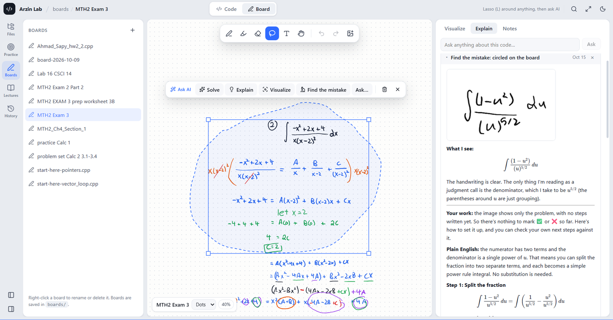

[README.md](https://github.com/user-attachments/files/33900463/README.md)

<h1 align="center">Ahmad Sapy</h1>

  <b>Computer Science · Chabot College</b> 
  4.00 GPA · Transferring Fall 2028 
  Electrical Engineering and Computer Sciences

  <a href="https://www.linkedin.com/in/ahmad-sapy-a95606382/">LinkedIn</a> ·
  <a href="mailto:arzinsy@gmail.com">arzinsy@gmail.com</a> ·
  Hayward, California

  
  
  
  
  

 

I build things in order to understand them, and I verify instead of assuming.

That has turned into a renderer written with no libraries so I could see what a GPU actually does, a debugger that draws what memory is doing instead of describing it, and a firewall whose every rule I tested by sending traffic at it rather than trusting the config file.

Founder of **Arzin Systems LLC**, bringing routine vulnerability scanning to Bay Area small businesses that currently have none.

 

---

## What I'm building

###  &nbsp;[arzin-lab](https://github.com/AHMAD-ARZIN-CS/arzin-lab)

**A workspace that runs your code and shows you what it's doing.**

Executes C, C++, Python, JavaScript, Java and Bash inside an isolated Docker container, with live input, interrupt, and errors marked on the offending line.

The part I care about is the visualizer. It traces execution step by step and draws what is actually happening in memory: stack frames, recursion depth, vectors with index markers, pointers, references, linked structures. Built on `gdb` for the compiled languages and `sys.settrace` for Python.

`TypeScript` · `Docker` · `gdb` · `React` · `Node`

A board mid-exam-prep. Lasso any handwriting, then Solve, Explain, Visualize or Find the mistake. It reads the handwriting back as typeset math first, so you can see whether it understood you before you trust the answer.

<b>Also in that repo: a 3D renderer written from scratch in Python, no libraries</b>

 

[`modules/01-3d-from-scratch`](https://github.com/AHMAD-ARZIN-CS/arzin-lab/tree/main/modules/01-3d-from-scratch)

Matrix pipeline, perspective divide, edge-function rasterizer, z-buffer, backface culling, Lambert shading. Built across four runnable steps so every stage prints its own numbers and you can follow a single point from model space to pixel.

I wrote it because "the GPU handles it" is not an explanation.

 

###  &nbsp;Segmented security homelab

**Three network zones, and every rule verified rather than trusted.**

Specified and built the host from components against a fixed budget, targeting local LLM inference plus multi-VM virtualization. Ryzen 7 5700X, 64 GB DDR4, RX 6600.

Three Linux VMs with separate user accounts, resource limits and scheduled backups. A three-zone firewall policy isolating the security zone from the office zone, with every rule verified by generating traffic across each zone boundary.

`Linux` · `KVM` · `iptables` · `Nmap` · `OpenVAS` · `SSHguard` — writeup and configs going up as their own repo

 

###  &nbsp;[East Bay Linked](https://github.com/AHMAD-ARZIN-CS/Hack3.0-FrontEnd)

**A campus hub, built privacy-first. Won the Accessibility Award at MESAU Hacks 3.0.**

Course help, housing, food assistance, campus resources and a textbook marketplace for students at Chabot, Diablo Valley and Cal State East Bay, all filtered to the student's own campus.

Privacy was a constraint, not a feature. No phone numbers, emails or home addresses are displayed. Housing shows the area only, never an exact address. Content can be marked helpful, but people are never rated.

Accessibility designed in from the start: contrast ratios, tap target sizing, keyboard navigation throughout.

 

###  &nbsp;AI automation pipeline

**In production. Writeup in progress.**

A multi-stage pipeline producing 20 to 30 reviewed drafts per run. It scopes to businesses in a target area, extracts contacts, drafts messages, scores its own output against criteria, and routes results for human approval. Currently hardening source-selection criteria and documenting failure modes before the repo goes public.

 

---

##  &nbsp;Research

**Student Research Assistant** · Office of Research, Planning and Institutional Effectiveness, Chabot College · Aug 2026 to present

Nine institutional reporting projects in two months, covering student satisfaction, veteran enrollment, tutoring outcomes and accreditation.

- Analyzed 503 survey responses across four files
- Built demographic and outcome reporting on thousands of student records spanning four to seven academic years, integrating Bureau of Labor Statistics and Census ACS data
- Read and modified existing R analysis code I had not seen before, to regenerate statistical graphs across demographic groups

 

---

<h3>More detail</h3>

 

**Systems** — Linux (Ubuntu), KVM virtualization, network segmentation, firewall configuration and rule verification, SSH, access control, scheduled backup and recovery

**Security** — OpenVAS, Nmap, SSHguard, network zone isolation, risk-ranked reporting for non-technical readers

**Programming** — C++, Python, Git, Bash (basic)

**Data** — Excel (advanced), R (reading and modifying existing analysis code)

**Coursework** — Information Systems Security · Linux/Unix Administration · Structured Programming in C++ · Calculus I and II · Data Analysis with Excel. Academic Honors List, Spring 2026. Studying for CompTIA A+.

**Also** — 2nd Place (Silver), Novice IPDA, International Public Debate Association, October 2026 · Chabot Forensics Team · MESA · Computer Science Club · STEM mentor, Lego Brick by Brick

**Earlier work** — [password-checker](https://github.com/AHMAD-ARZIN-CS/password-checker) · [starflight-game](https://github.com/AHMAD-ARZIN-CS/starflight-game) · [community-links-projects](https://github.com/AHMAD-ARZIN-CS/community-links-projects)

 

English · Arabic · Pashto

